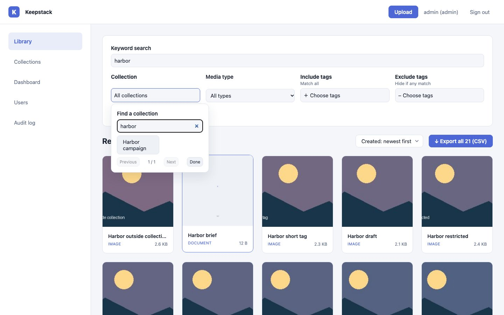
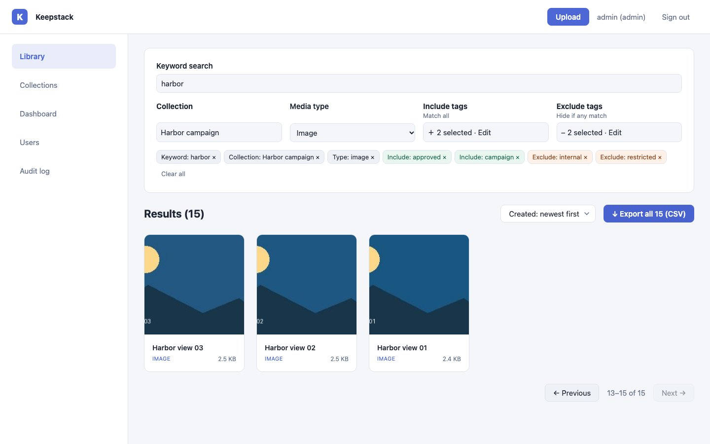
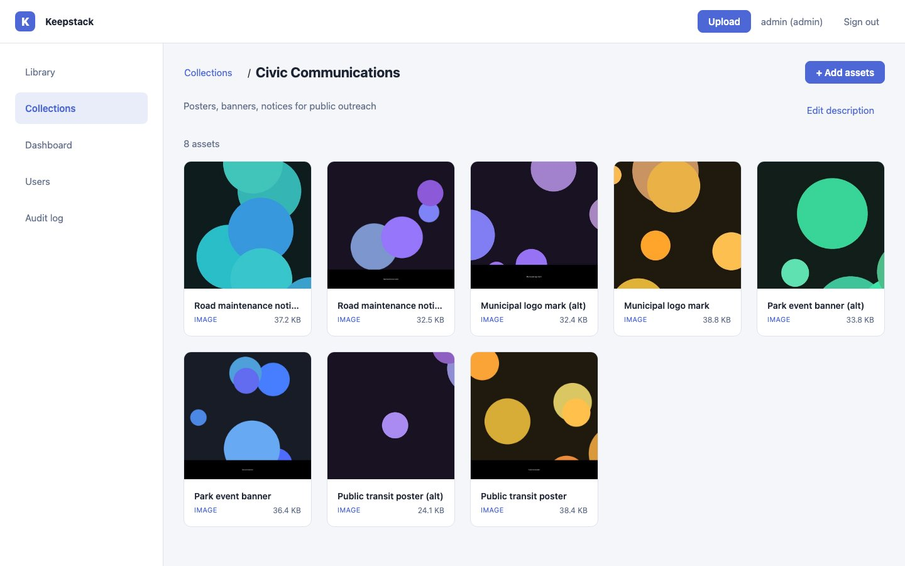
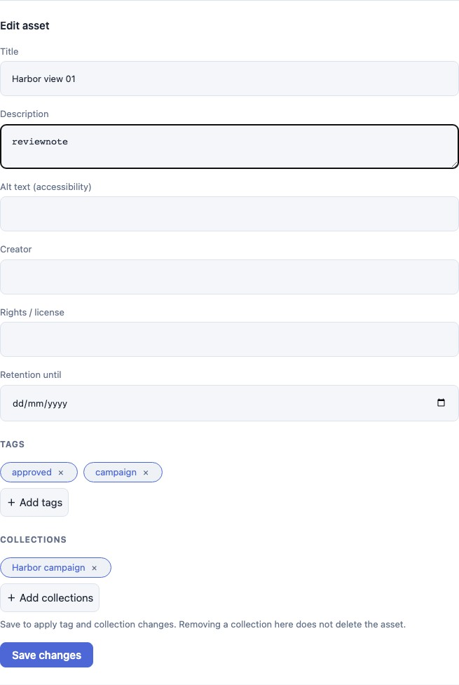
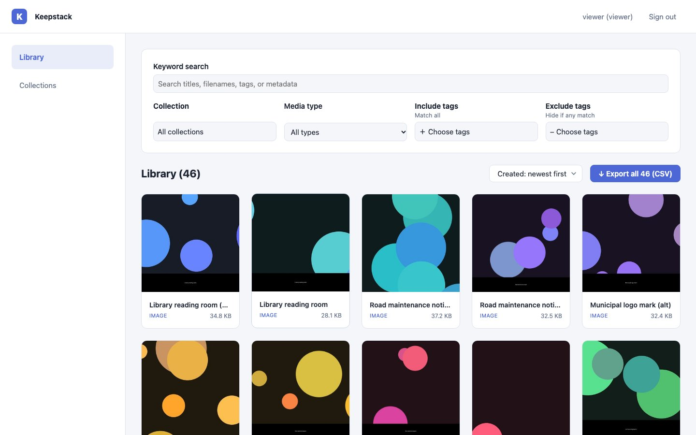
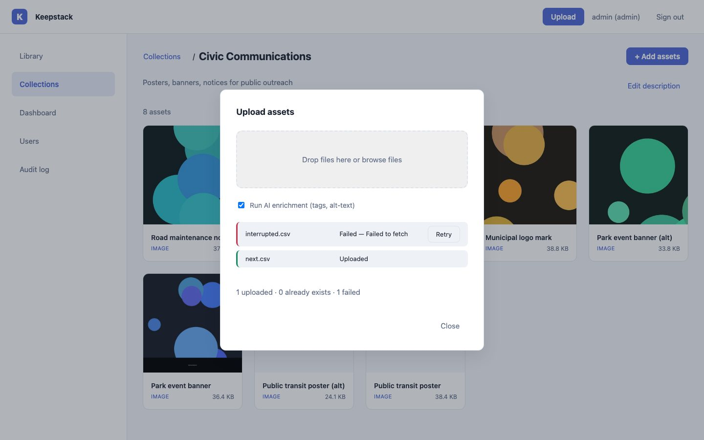

# Keepstack 素材检索测评

[Fork](https://github.com/grumpykendal0622/AI-Engineer-Quiz) · [分支 `codex/asset-search`](https://github.com/grumpykendal0622/AI-Engineer-Quiz/tree/codex/asset-search) · [Draft PR 与最终提交](https://github.com/grumpykendal0622/AI-Engineer-Quiz/pull/1)

这次在 Keepstack 的 Library 加了一条可直接操作的流程。内容运营能把关键词、集合、素材类型和标签叠加起来，看清筛选后的结果，再下载整批素材的 CSV 清单。下面按[题目 README](README.md)的四项要求说明做了什么、怎么验。

## 运行与演示账号

已有演示服务时直接打开 [http://127.0.0.1:8011](http://127.0.0.1:8011)。README 的 `8000` 是应用默认端口，此处的 `8011` 是演示实例的配置。

从干净 checkout 启动时，在仓库根目录运行下列命令。需要 Python 3.10+。若 `8011` 已被占用，把 `KEEPSTACK_PORT` 改成空闲端口，例如 `8012`，然后打开对应地址。

```bash
python3 -m venv .venv
.venv/bin/python -m pip install -e '.[dev]'
export KEEPSTACK_DATA_DIR="$(mktemp -d "${TMPDIR:-/tmp}/keepstack-review.XXXXXX")"
export KEEPSTACK_AI_ENABLED=false KEEPSTACK_OCR_ENABLED=false
export KEEPSTACK_HOST=127.0.0.1 KEEPSTACK_PORT=8011
export KEEPSTACK_BASE_URL="http://127.0.0.1:${KEEPSTACK_PORT}"
.venv/bin/python -m keepstack seed
.venv/bin/python -m keepstack.seed_search
.venv/bin/python -m keepstack
```

`seed` 生成演示账号和基础素材，`seed_search` 生成题目的 Harbor 场景。每次重新验收可用新的临时数据目录。下表是这套种子数据的本地账号。点右上角 **Sign out** 就能换角色。

| 角色 | 用户名／密码 | 能看到的页面和操作 |
| --- | --- | --- |
| Viewer | `viewer`／`demo1234` | 侧栏有 **Library、Collections**。能搜索、排序、翻页、导出 CSV、查看集合及素材详情、下载原文件。隐藏上传、编辑、分享创建和删除入口。 |
| Contributor | `contributor`／`demo1234` | 同样看到 **Library、Collections**，右上角增加 **Upload**。能编辑素材和标签、创建分享链接、新建集合、改描述及增减成员。隐藏删除素材和集合的入口。 |
| Editor | `curator`／`demo1234` | 同样看到 **Library、Collections**。拥有 Contributor 的操作，另外能删除素材和集合。 |
| Admin | `admin`／`admin` | 在 Editor 基础上，侧栏多出 **Dashboard、Users、Audit log**。可以运行完整性检查、添加用户和查看审计记录。 |

## 1. 组合筛选

- **关键词**沿用原来的全文搜索。可搜标题、描述、文件名、标签等已索引内容。搜索框留空就不限关键词。
- **Collection** 可以搜索集合名、翻页、单选，也可以选 **All collections**。**Media type** 可继续限制图片、视频等类型。
- **Include tags** 选两个标签时，素材必须同时带有这两个标签。**Exclude tags** 选两个标签时，素材只要带其中任何一个就会被排除。标签按完整名称匹配，`camp` 和 `campaign` 是不同标签。大小写和重复输入不改变结果。同一标签同时包含和排除时，页面提示冲突并显示零条。
- 所有条件必须同时满足，结果只显示在库素材。生效条件列在筛选栏下方，可以单独移除，也可以点 **Clear all**。标题显示当前匹配数。

**怎么验。** 用 Admin 登录，在 Library 搜 `harbor`，将 **Collection** 设为 **Harbor campaign**，类型选 **Image**，包含 `approved` 和 `campaign`，排除 `internal`。干净的演示数据会匹配 **16 条**。再排除 `restricted`，会少一张带该标签的图片，剩 **15 条**。

## 2. 排序与分页

- 可按创建时间选择最新或最早优先，输入关键词后也按这个顺序排列。每页 12 条，页面会显示总数和上一页／下一页。
- 创建时间相同的素材按固定顺序排列。测试逐页核对过，同一批数据翻页时没有重复或遗漏。
- 改筛选或排序回到第一页。测试故意让旧搜索晚回来，页面仍显示刚刚选择的条件。没有匹配素材时提示调整筛选，接口失败时可以点 **Retry**。非法分页参数会被拒绝，引号、星号和中文等搜索输入可以正常提交。

**怎么验。** 用上面的 15 条结果，第一页有 12 张，第二页有 3 张。留在第二页切到最早优先，页面会回到第一页，最早的素材排到前面。

## 3. 导出全部匹配结果

- **Export all (CSV)** 下载整个搜索结果。文件沿用点击时的关键词、集合、类型、标签和排序。只要能按当前角色查看这些结果，登录后就能下载清单。
- 列为 `uuid`、`title`、`description`、`filename`、`media_type`、`tags`、`created_at`。多个标签写成 JSON 数组，例如 `["approved","campaign"]`，无标签写成 `[]`。
- 实测中文、逗号、引号和字段内换行可以完整读回。零条结果仍可下载表头。下载失败会显示提示。CSV 只包含清单，原文件可在素材详情单独下载。

**怎么验。** 在第二页还只看到 3 张图时，点 **Export all 15 (CSV)**。打开文件会有 **15 行数据**。测试还逐条核对过，文件顺序和两页列表拼起来一致。

## 4. 修改后结果正确

- 在 Library 或 Collections 点开任一素材，使用同一个详情抽屉。标题、描述、标签和所属集合可以一起改，点一次 **Save changes** 生效。标签和集合选项都可以搜索和翻页。
- 保存后用新内容搜索，可以在列表和新下载的 CSV 里看到修改。增删标签或集合成员也会影响它能否被相应条件选中。保存失败时草稿保留，可重试。

**怎么验。** 给 `Harbor view 01` 的描述加上 `reviewnote`，保存后在 Library 搜这个词。该素材会出现，下载的 CSV 能读到新描述。这条流程已用真实页面和下载文件复测。

## 补充完成的功能和取舍

- **Collections 负责管理集合。** 可以新建空集合、填写或编辑可选描述、看成员、批量加素材。用详情抽屉可以把素材移出集合或加入其他集合。移出成员和删除集合都保留原素材。Library 的集合选项、列表和 CSV 随集合变化更新。
- **Library 负责跨集合找素材和导出。** 将原侧栏标签和素材类型入口放到 Library 筛选区，使条件和结果在同一页。Collections 保留浏览与成员管理。Dashboard、Users 和 Audit log 继续由 Admin 打开。保留 FastAPI、SQLite／FTS5 和原生 JavaScript。
- **上传和失败恢复。** 每个文件显示排队、上传中、成功、重复或失败。测试中断一个文件后，其余文件继续，恢复连接后可以单独重试。Viewer 的空库只提示暂无素材。详情主请求、嵌入元数据和相似素材各自可重试，编辑草稿保留。

## 自动化验证与剩余限制

本地运行下列命令，测试会自建临时数据。已在干净数据上走完上面的 Harbor 操作，并逐个用四种账号检查可见页面与操作。

```bash
.venv/bin/python -m pytest -q
.venv/bin/python -m pip install -e '.[dev,e2e]'
.venv/bin/python -m playwright install chromium
.venv/bin/python -m pytest -q tests/e2e_workflows.py
```

[GitHub Actions](https://github.com/grumpykendal0622/AI-Engineer-Quiz/actions/runs/45770028095) 验证提交 `257072fe8eed990b7863eb65db59b8745a1234df`。Python 3.10、3.12 各 42 通过、1 跳过（缺 CLIP 模型），Playwright 11 通过。最终评审提交 SHA 与文档更新后的检查见 [Draft PR](https://github.com/grumpykendal0622/AI-Engineer-Quiz/pull/1)。附有[逐项边界验证](docs/asset-search-stories.md)和[后续清单](TODO.md)。

- **上传与容量。** 图片和其他素材默认单文件上限 1024 MiB，可配置。支持图片、文档、视频和音频，预览随格式而异。空文件和损坏的光栅图会被拒绝。按文件内容去重，重试会从该文件开头上传。CSV 测过 207 条，浏览器会先接收完整文件。列表与 CSV 的一致性以数据不变为前提。
- **未完成及范围外。** 分享、删除素材及 Users／Dashboard 的失败提示还有改进空间。保留现有相似素材和留存日期功能。后台导出、实时同步、语义检索优化、自动留存和在线部署均在本题范围外。

## 关键页面截图

**Library 集合选择器。** 输入 `harbor` 后可以选中 Harbor campaign，再叠加标签和素材类型。



**分页与 CSV。** 当前页显示第 13–15 条，按钮仍会导出全部 15 条。



**Collections。** 集合内先读描述，再看成员，有权限时可点 Add assets。



**素材详情。** 在同一表单改描述、标签和所属集合，并统一保存。



**Viewer。** 可在 Library 搜索和导出，界面隐藏 Upload 和管理页。



**上传中断。** 界面保留成功项，在失败文件一行提供 Retry。


