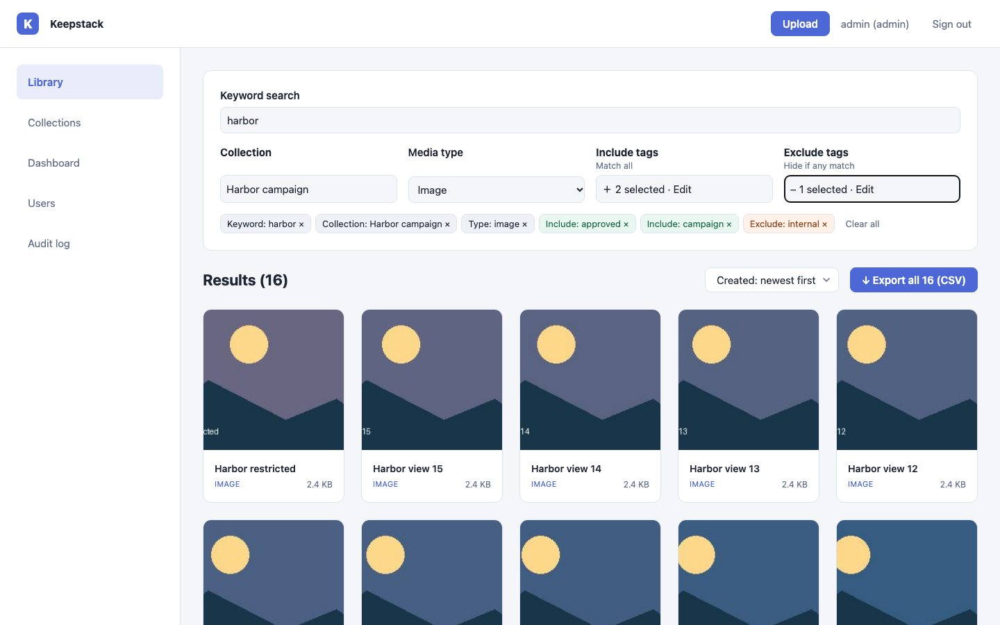
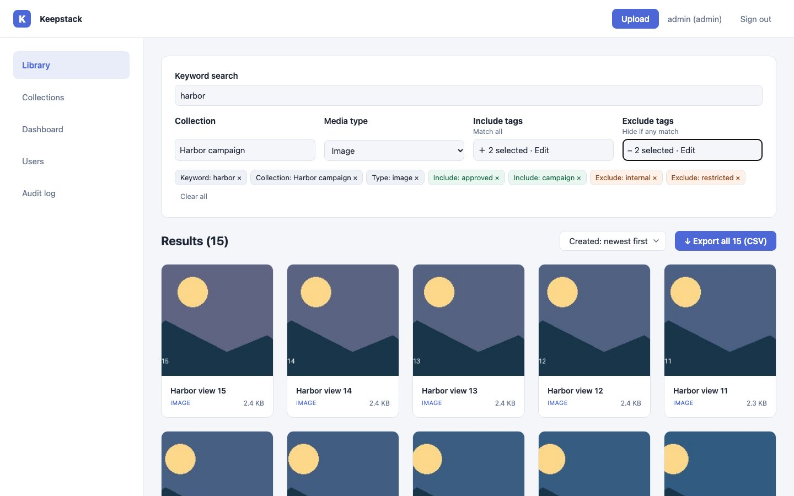
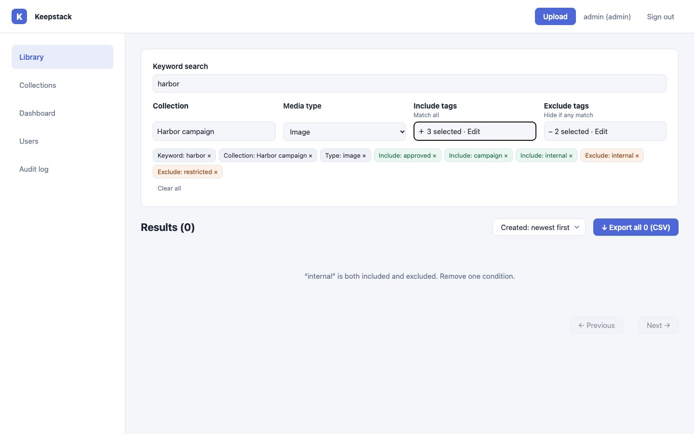
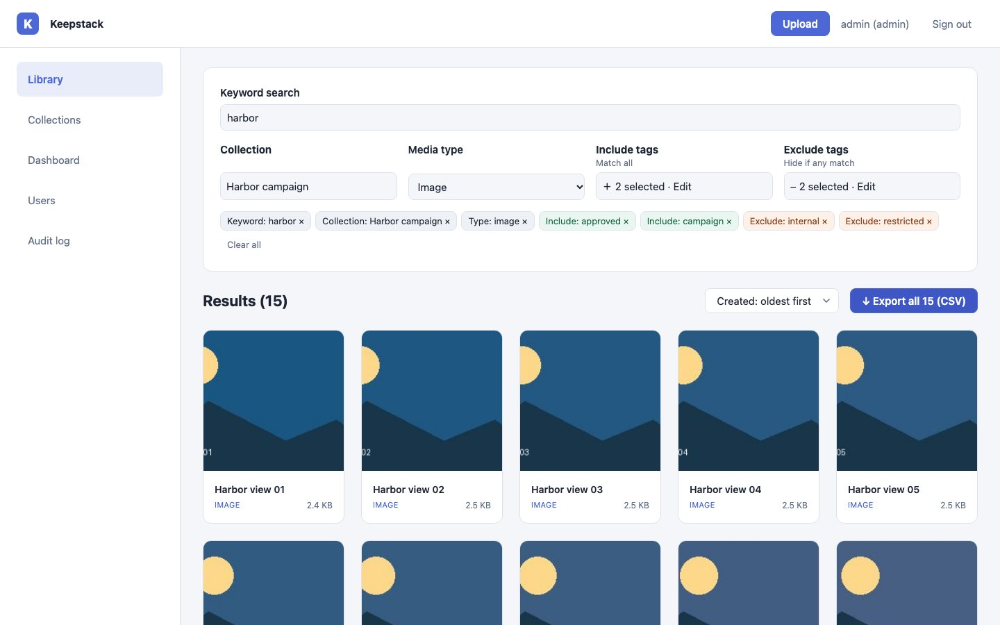
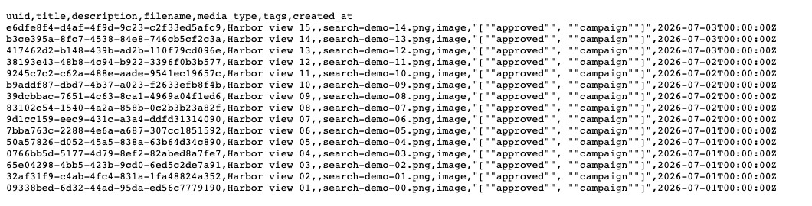
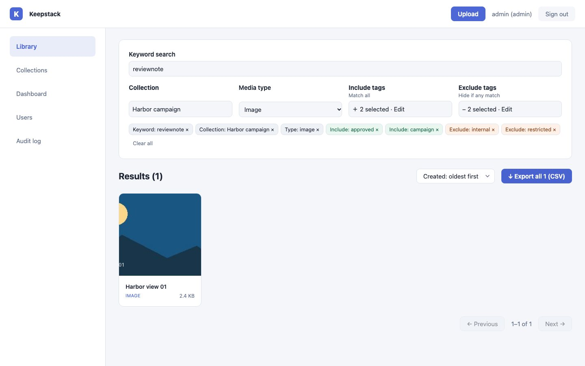
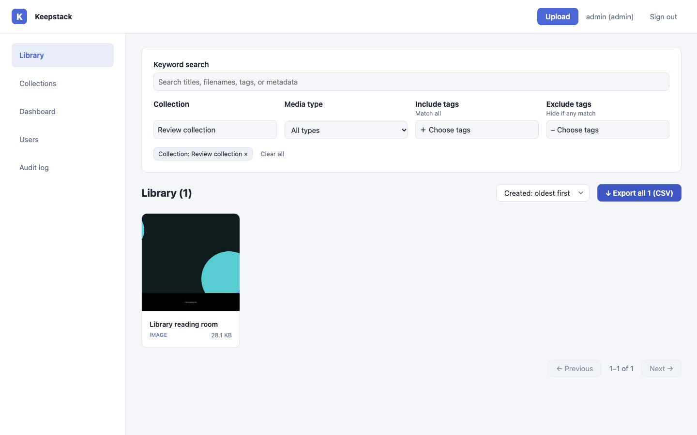
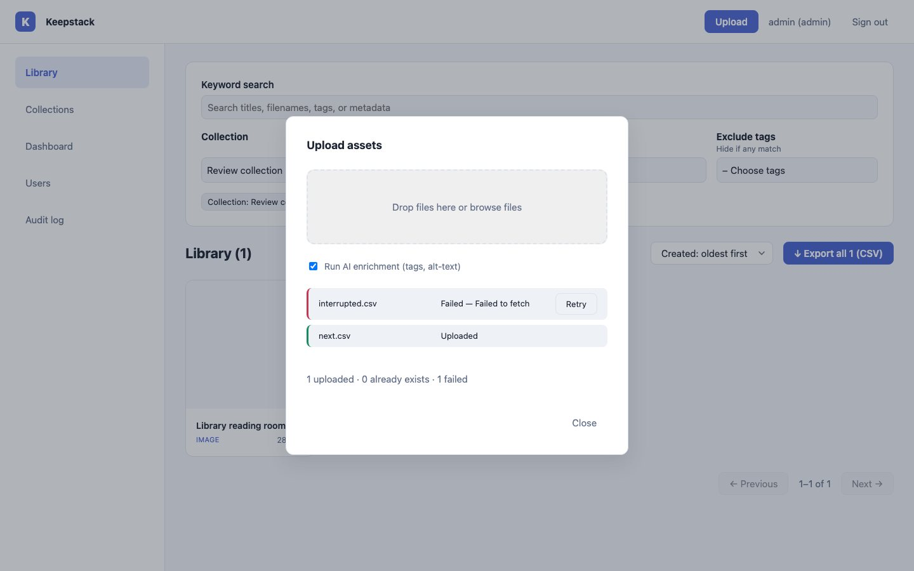

# Keepstack — 素材检索与结果导出

- Fork：[AI-Engineer-Quiz](https://github.com/grumpykendal0622/AI-Engineer-Quiz)
- 分支：[codex/asset-search](https://github.com/grumpykendal0622/AI-Engineer-Quiz/tree/codex/asset-search)
- 验收代码 Commit：`443bbeafecf96e5b2ac5be60cf13cad535d09665`
- [Pull Request](https://github.com/grumpykendal0622/AI-Engineer-Quiz/pull/1) | [CI](https://github.com/grumpykendal0622/AI-Engineer-Quiz/actions/runs/45771011402)

## 1. 本地运行

环境要求为 Python 3.10+。克隆仓库并切换至 `codex/asset-search` 分支，在项目根目录执行：

```bash
python3 -m venv .venv
source .venv/bin/activate
pip install -e '.[dev]'

export KEEPSTACK_DATA_DIR="$(mktemp -d "${TMPDIR:-/tmp}/keepstack-review.XXXXXX")"
export KEEPSTACK_HOST=127.0.0.1
export KEEPSTACK_AI_ENABLED=false
export KEEPSTACK_OCR_ENABLED=false

python -m keepstack seed
python -m keepstack.seed_search
python -m keepstack
```

访问 [http://localhost:8000](http://localhost:8000)。已经在 `8011` 启动本地演示服务时，可直接访问 [http://127.0.0.1:8011](http://127.0.0.1:8011)。

`seed` 生成基础素材及演示账号，`seed_search` 生成用于验收的 Harbor 场景数据。两步使用临时数据目录，运行时无需额外准备素材或模型。

### 演示账号

| 角色 | 用户名 | 密码 | 可见页面及主要权限 |
| --- | --- | --- | --- |
| Viewer | `viewer` | `demo1234` | Library、Collections。可浏览、检索、导出和下载。 |
| Contributor | `contributor` | `demo1234` | Library、Collections、Upload。另可编辑素材、创建分享链接、新建集合、编辑描述及管理成员。 |
| Editor | `curator` | `demo1234` | Library、Collections、Upload。拥有 Contributor 的操作，另可删除素材和集合。 |
| Admin | `admin` | `admin` | 拥有 Editor 的操作。侧栏另有 Dashboard、Users、Audit log，可运行完整性检查、添加用户和查看审计记录。 |

## 2. 核心功能

### 2.1 组合筛选

Library 支持以下条件同时生效。

| 筛选条件 | 匹配规则 |
| --- | --- |
| Search | 沿用原有 FTS5 搜索字段及分词方式，留空时不限制关键词 |
| Collection | 选择单个集合或全部集合 |
| Media type | 按素材类型筛选 |
| Include tags | 必须包含全部指定标签（AND） |
| Exclude tags | 包含任意指定标签即排除（OR） |

所有条件取交集，仅返回 `active` 素材。标签按完整名称匹配，沿用原有大小写处理规则。重复标签不影响结果，同一标签同时被包含和排除时返回空结果。

页面展示当前生效条件及匹配总数，支持修改、单独移除和一键清除。集合及标签选择器支持搜索和分页。

### 2.2 排序与分页

- 支持按创建时间升序、降序排列，包括关键词搜索结果。
- 每页展示 12 条素材，提供上一页、下一页及匹配总数。
- 创建时间相同时使用 ID 作为次级排序依据，保证数据不变时跨页无重复、无遗漏。
- 修改筛选或排序后自动返回第一页。快速更换条件时，页面采用最新查询的结果。
- 支持空结果提示、加载失败重试、非法分页参数校验及特殊字符输入。

### 2.3 导出全部匹配结果

Library 提供 CSV 下载入口，导出全部匹配素材。关键词、集合、素材类型、标签及排序均与列表保持一致。

字段为 `uuid`、`title`、`description`、`filename`、`media_type`、`tags`、`created_at`。多标签采用 JSON 数组格式，例如 `["approved","campaign"]`，无标签时为 `[]`。

支持中文、逗号、引号及字段内换行，零条结果时保留表头。下载沿用现有登录鉴权，失败时提供错误提示。CSV 只包含素材信息，原文件通过素材详情下载。

### 2.4 编辑后查询与导出一致性

Library 与 Collections 共用素材详情，支持统一编辑标题、描述、标签及所属集合。

保存后，后续关键词查询、标签筛选、集合筛选及 CSV 导出均反映最新数据。保存失败时保留编辑内容，支持重试。

## 3. 补充功能

### 3.1 集合管理

Library 负责跨集合检索和导出，Collections 负责集合浏览及成员管理。

- 可创建空集合、编辑集合描述及批量添加素材。
- 可在素材详情中添加或移除所属集合。
- 移除成员或删除集合时，原素材仍可在 Library 中找到。
- 集合及成员变更后，Library 筛选选项、查询结果和 CSV 导出同步更新。

### 3.2 上传与失败恢复

批量上传时，每个文件独立显示排队、上传中、成功、重复或失败状态，并提供批次结果汇总。单个文件失败后，其余文件继续上传，失败项可独立重试。

用 SHA-256 按文件内容去重。支持单文件大小校验、空文件及损坏图片检测。素材详情及其附属区块加载失败时也可以重试。

## 4. 功能验收

使用 Admin 账号登录，在初始演示数据上进行以下操作。点击截图可查看原图。

| 验收场景 | 操作 | 实测结果 | 验收截图 |
| --- | --- | --- | --- |
| 组合筛选 | 搜索 `harbor`，选择 Harbor campaign 集合，类型设为 Image，包含 `approved`、`campaign`，排除 `internal`。 | 16 条。 | [](docs/screenshots/acceptance/01-combined-filters.jpg) |
| 多标签排除 | 继续排除 `restricted`。 | 15 条。 | [](docs/screenshots/acceptance/02-multiple-exclusions.jpg) |
| 标签冲突 | 在排除 `internal` 的同时，将它加到包含标签。 | 0 条，页面提示标签冲突。 | [](docs/screenshots/acceptance/03-tag-conflict.jpg) |
| 分页 | 移除刚加的包含标签 `internal`，浏览上述 15 条结果。 | 第一页 12 条，第二页 3 条。 | [](docs/screenshots/acceptance/04-second-page.jpg) |
| 排序 | 在第二页切换为按创建时间最早优先。 | 返回第一页，最早的素材排在前面。 | [](docs/screenshots/acceptance/05-oldest-first.jpg) |
| 全量导出 | 切回最新优先，翻到第二页，点击 **Export all 15 (CSV)**。 | 实际下载 15 行数据，顺序与当前排序下两页拼接一致。 | [](docs/screenshots/acceptance/06-downloaded-csv.jpg) |
| 编辑一致性 | 为 Harbor view 01 添加描述 `reviewnote` 并保存，然后搜索该词。 | 搜到该素材，重新下载的 CSV 包含新描述。 | [](docs/screenshots/acceptance/07-search-after-edit.jpg) |
| 集合管理 | 向新集合加入两个素材，再从详情移除其中一个。回到 Library 筛选该集合。 | 列表和 CSV 先后从 2 条变为 1 条。 | [](docs/screenshots/acceptance/08-collection-membership.jpg) |
| 上传恢复 | 模拟单个文件上传中断，再点失败文件的 **Retry**。 | 第二个文件正常上传，重试后两个文件均上传成功。 | [](docs/screenshots/acceptance/09-upload-retry.jpg) |

以上九项均已通过浏览器验证。第六项截图展示实际下载的 CSV，第九项截图展示点击重试前的状态。

## 5. 技术实现与取舍

| 设计选择 | 原因 |
| --- | --- |
| 保留 FastAPI、SQLite / FTS5、原生 JavaScript | 现有技术栈可满足需求，部署和维护继续沿用项目已有方式。 |
| 统一列表与导出的查询逻辑 | 同一处定义筛选规则，列表与 CSV 采用相同条件。 |
| 创建时间与 ID 组合排序 | 创建时间相同时仍有确定顺序，分页保持稳定。 |
| 服务端筛选与分页 | 浏览器按需接收当前页素材。 |
| 前端异步请求控制 | 快速切换筛选条件时，只有最新请求的结果可以更新页面。 |
| 编辑与索引更新放在同一事务 | 素材数据和搜索索引一起更新，失败时一起回滚。 |
| 同步 CSV 导出 | 满足当前数据规模及题目需求。 |
| 沿用现有角色权限 | 前端按角色提供操作入口，后端独立鉴权。 |

页面设计将检索条件集中在 Library，集合管理集中在 Collections，保留原有素材管理能力。

## 6. 自动化测试

### 运行方式

```bash
python -m pytest -q

pip install -e '.[dev,e2e]'
python -m playwright install chromium
python -m pytest -q tests/e2e_workflows.py
```

测试独立生成临时数据，无需依赖已有数据库。

### 测试结果

| 测试环境 | 通过 | 失败 | 跳过 |
| --- | ---: | ---: | ---: |
| Python 3.10 | 42 | 0 | 1 |
| Python 3.12 | 42 | 0 | 1 |
| Playwright E2E | 11 | 0 | 0 |

跳过的是依赖 CLIP 模型的测试。

### 主要测试覆盖

| 测试范围 | 覆盖内容 |
| --- | --- |
| 组合筛选 | 条件交集、多标签、完整名称匹配、大小写、重复及冲突标签、素材状态 |
| 排序与分页 | 升降序、相同创建时间、跨页重复与遗漏、筛选变更、旧请求晚到 |
| CSV 导出 | 多页结果一致性、207 条数据导出、素材类型、特殊字符、空结果、鉴权及下载失败 |
| 编辑一致性 | 新旧关键词、标签增删、集合成员变更、索引更新及事务回滚 |
| 集合管理 | 创建、删除、重复添加、批量操作、描述编辑及原素材保留 |
| 上传与异常恢复 | 内容去重、无效文件、大小限制、网络中断及单文件重试 |
| 权限控制 | 四种角色、未登录请求及越权操作 |

[GitHub Actions 测试记录](https://github.com/grumpykendal0622/AI-Engineer-Quiz/actions/runs/45771011402) | [详细验证记录](docs/asset-search-stories.md)

## 7. 已知限制与未完成项

题目要求的四项核心功能均已完成。

- **大规模导出。** 已验证 207 条素材的导出一致性。超大规模数据的容量和性能仍待测量。
- **并发修改。** 分页及导出的一致性以数据不变为前提。跨请求快照和多人编辑冲突检测未实现。
- **上传恢复。** 支持单文件重试。每次重试从该文件开头重新上传。
- **异常处理。** 分享、素材删除及部分后台管理页面的错误提示还有完善空间。

语义检索优化、异步导出、实时同步及线上部署属于题目范围之外。
